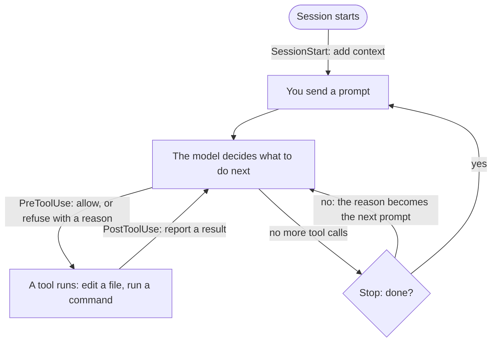

# Hooks

A hook is a command your coding agent runs by itself at a fixed moment: when a session starts, before it uses a
tool, after it used one, or when it wants to stop. The hook reads what is about to happen, or what just happened,
and can answer: refuse the action, report a result the agent must take in, or add context.

An instruction in `AGENTS.md` or a skill is a request: the agent may forget it, or decide it does not apply. A hook
is not up to the agent. That makes hooks the place for rules that must hold every time, and for checks that are
cheap enough to run after every edit.

Lab 7 wires the four hooks under `hooks/` and has you write one of your own. This page is what you need for both.

## Where a hook acts



Every tool call passes the two hooks in the middle. A refused call never runs, and the agent gets the reason
instead. A result reported after a call reaches the model before it decides its next step, so it fixes what the hook
found while the change is still fresh.

## The events

Claude Code, Codex and GitHub Copilot share these events, each under its own name:

| Moment | Claude Code | Codex | GitHub Copilot | A hook can |
|---|---|---|---|---|
| A session starts | `SessionStart` | `SessionStart` | `sessionStart` | add context: what the agent should know from the start |
| Before a tool runs | `PreToolUse` | `PreToolUse` | `preToolUse` | let it through, or refuse it with a reason |
| After a tool ran | `PostToolUse` | `PostToolUse` | `postToolUse` | report a result the agent must take into account |
| The agent wants to stop | `Stop` | `Stop` | `agentStop` | send it back to work, with a reason. After eight times in a row the agent stops anyway |
| A prompt is sent | `UserPromptSubmit` | `UserPromptSubmit` | `userPromptSubmitted` | Claude Code and Codex: block it or add context. Copilot: only observe it |

Each agent has more: for subagents, compaction, permissions, notifications and the end of a session. Their own
documentation lists them all:
- Claude Code: [hooks reference](https://code.claude.com/docs/en/hooks) and [guide](https://code.claude.com/docs/en/hooks-guide);
- Codex: [hooks](https://learn.chatgpt.com/docs/hooks);
- GitHub Copilot: [hooks reference](https://docs.github.com/en/copilot/reference/hooks-reference) and
  [about hooks](https://docs.github.com/en/copilot/concepts/customizations/hooks). Copilot's cloud agent supports
  fewer events than the CLI.

## How a hook answers

The agent starts the hook's command and passes a JSON object on its standard input: the event, the tool and its
arguments, the working directory. The hook answers with its exit code and its output:

- **Let the action through:** exit 0 and print nothing. This is the answer to almost every call.
- **Refuse it** (before a tool): exit 2, with the reason on standard error. Copilot also expects
  `{"permissionDecision": "deny", "permissionDecisionReason": "..."}` on standard output. The agent sees the reason
  and tries something else, so write it for the agent: what is wrong, and what to do instead.
- **Report a result** (after a tool): exit 2, with the result on standard error, for Claude Code and Codex. Copilot
  expects `{"additionalContext": "..."}` on standard output. Plain output with exit 0 after a tool does not reach the
  model in every agent.
- **Add context** (at the start of a session): print the text and exit 0. Copilot expects
  `{"additionalContext": "..."}` instead.

Every agent sends a different JSON object, so `hooks/hookio.py` does the translating:
- `read_call()` reads the input of any of the three agents into one `Call`: an edit with the files it changes, a shell
  command, or the start of a session;
- `deny()`, `report()` and `context()` answer in the form the calling agent understands.

A hook built on it is written once and wired three times. When `hookio` cannot read its input, it lets the action
through and says so: a broken guardrail must not stop the agent.

## Wiring

Each agent reads its hooks from its own file in the repository:

| | Claude Code | Codex | GitHub Copilot |
|---|---|---|---|
| File | `.claude/settings.json` | `.codex/hooks.json` | `.github/hooks/<any name>.json` |
| Event names | `PreToolUse`, `PostToolUse`, ... | the same | `preToolUse`, `postToolUse`, ... |
| Edit tools | `Write`, `Edit` | `apply_patch` | `create`, `edit`, `apply_patch` |
| Shell tool | `Bash` (`PowerShell` on Windows) | `Bash` | `bash`, `powershell` |
| The command | `"command"` | `"command"` | `"bash"` and `"powershell"` |
| Timeout | `"timeout"`, default 600 s | `"timeout"`, default 600 s | `"timeoutSec"`, default 30 s |

The matcher is a pattern for the tool's name. It never sees the file: a hook for `.robot` files matches every edit,
and its script decides which files it cares about.

### After every edit

The smallest useful hook writes down what the agent changed. `hooks/log_edits.py`, if you want to try it:

```python
"""After an edit: append the edited files to results/edits.log."""
from hookio import ROOT, read_call

call = read_call()
if call is not None and call.kind == "edit":
    with open(ROOT / "results" / "edits.log", "a", encoding="utf-8") as log:
        for edit in call.edits:
            log.write(f"{call.agent}: {edit.path.as_posix()}\n")
```

It answers nothing, so the agent never notices it. Wired after every edit, for each agent:

```json
{
  "hooks": {
    "PostToolUse": [
      {
        "matcher": "Write|Edit",
        "hooks": [{"type": "command", "command": "uv run --no-sync --project \"$CLAUDE_PROJECT_DIR\" python \"$CLAUDE_PROJECT_DIR/hooks/log_edits.py\""}]
      }
    ]
  }
}
```

```json
{
  "hooks": {
    "PostToolUse": [
      {
        "matcher": "^apply_patch$",
        "hooks": [{"type": "command", "command": "uv run --no-sync python hooks/log_edits.py"}]
      }
    ]
  }
}
```

```json
{
  "version": 1,
  "hooks": {
    "postToolUse": [
      {
        "type": "command",
        "matcher": "^(create|edit|apply_patch)$",
        "bash": "uv run --no-sync python hooks/log_edits.py",
        "powershell": "uv run --no-sync python hooks/log_edits.py"
      }
    ]
  }
}
```

The first is Claude Code's, the second Codex's, the third Copilot's. Claude Code's command names the project
directory, so it works wherever in the repository the session is; Codex and Copilot run hooks from the repository's
root.

### Only after an edit to a `.robot` or `.resource` file

Same wiring, one more line in the script:

```python
for edit in call.edits:
    if edit.path.suffix in (".robot", ".resource"):
        ...
```

That is how the hooks under `hooks/` pick their files: `no_inline_locators.py` looks only at `.robot` files under
`tests/`, and the static check below at `.robot` and `.resource` files under `tests/` and `resources/`.

## Worked example: the static check

`hooks/static_check.py` runs after every edit. For each edited `.robot` or `.resource` file under `tests/` and
`resources/`, it asks RobotCode whether the file still makes sense, without running it:

```bash
uv run robotcode analyze code tests/ui/checkout.robot
```

RobotCode resolves the file the way Robot Framework would: every keyword, variable and import, and the arguments of
each call. It needs no shop and no browser, and takes about two seconds. When the agent has misspelled a keyword, the
agent gets this back, right after its edit:

```text
Static check (robotcode analyze code): 1 error(s).
- tests/ui/checkout.robot:30:5: KeywordNotFound: No keyword with name 'Place Ordr' found.
```

Four choices keep it cheap, in time and in tokens:
- **Only the edited files.** The agent gets findings about the change it just made, not about files it never
  touched.
- **Only errors.** Warnings and hints are left out: mid-task, they are noise.
- **At most five lines**, plus a count of the rest, and no summary line.
- **Silence when the file is clean.** Most edits cost the agent nothing at all.

It is the first rung of a ladder. Each rung catches more, and costs more:

| Rung | Command | Takes | Needs | Catches |
|---|---|---|---|---|
| Static check | `uv run robotcode analyze code <file>` | about 2 s | nothing | unknown keywords and variables, wrong arguments, broken imports |
| Dry run | `uv run robotcode robot --dryrun <file>` | about 5 s | nothing | the same, by walking through the tests without executing a keyword |
| The tests | `hooks/run_affected_tests.py` | seconds to minutes | the shop | behaviour |

The static check and `run_affected_tests.py` run side by side after an edit: each does one job.

Why `robotcode robot`, and never plain `robot`? Plain `robot` ignores `robot.toml`, so it knows neither the shop's
address nor where `resources/` is. A dry run with it fails every test file:

```text
$ uv run robot --dryrun tests/api/smoke.robot
[ ERROR ] Error in file '.../tests/api/smoke.robot' on line 4: Resource file 'resources/api.resource' does not exist.
```

A hook built on that would report a failure after every edit, and teach your agent to ignore it.

To widen the check, drop the `[ERROR]` filter in the script: `analyze code` also reports warnings, information and
hints. [The RobotCode cheat sheet](robotcode.md#analyze) has its options.

## Context at the start of a session

A hook can tell the agent something before the first prompt. `hooks/shop_status.py` would tell it which shop it
works against, and which presets hold there:

```python
"""At the start of a session: the shop's address, space and presets, from python -m shop status."""
import subprocess
import sys

from hookio import ROOT, context, read_call

call = read_call()
if call is not None and call.kind == "session":
    status = subprocess.run([sys.executable, "-m", "shop", "status"], cwd=ROOT, capture_output=True, text=True)
    context(call, "The workshop's shop, from `python -m shop status`:\n" + status.stdout)
```

Wire it under `SessionStart` for Claude Code and Codex, and `sessionStart` for Copilot. These events have no tool, so
they need no matcher. Ask a new session which presets hold in the shop: the agent answers without running a command.

## Writing your own

Let your agent write it. Lab 7 gives you a prompt. The agent:
1. writes `hooks/<name>.py` on top of `hookio.py`, with the hooks next to it as examples;
2. wires it into your agent's file, next to the hooks already there;
3. tests it as a plain command and with a JSON object like the one your agent sends.

Then start a new session, trust the hooks if asked, and give a prompt that should trigger it.

Ideas for Robot Framework work:

| Hook | Event | Answer | What it guards |
|---|---|---|---|
| Use `robotcode`, not plain `robot`: refuse a shell command that runs `robot` or `python -m robot`, and name the right command | before a shell command | refuse | runs that ignore `robot.toml` |
| No shortcut to green: refuse an edit that adds the `broken` tag, `Skip`, `Run Keyword And Ignore Error` or `Pass Execution` to a test | before an edit | refuse | an agent that makes a test pass instead of making it right |
| Criterion ID first: refuse a new test whose name does not start with `<STORY>_<AC>` and that has no `smoke` tag | before an edit | refuse | [convention 1](conventions.md#1-the-criterion-id-comes-first) |
| The specs are the reference: refuse edits under `openspec/specs/shop/` | before an edit | refuse | a test that agrees with the shop by changing what the shop should do |
| Robocop on the edited file: `uv run robocop check <file>` | after an edit | report | style, in about a second |
| The shop's status at the start of a session, as above | session start | context | an agent that guesses which shop and presets it works against |

A hook that runs at every stop, and sends the agent back to work while the suite is red, is tempting too. Each
round costs a full turn of tokens, and a test that cannot pass keeps the agent going until it gives up after
eight rounds. Keep that for a demo.

What makes a good hook:
- **Fast.** It runs every time: seconds, not minutes.
- **Quiet.** Nothing when all is well; when not, only what the agent needs to act.
- **One job.** Two small hooks are easier to trust than one clever one.
- **A reason the agent can act on.** "Refused" teaches nothing; "use `uv run robotcode robot` instead" does.
- **Open when broken.** If it cannot read its input, it lets the action through, as `hookio` does.

To switch a hook off, remove its entry from your agent's file, and start a new session. Claude Code lists the active
hooks with `/hooks`, and Codex shows them with `/hooks`, where it also asks you to trust new or changed ones.

## Trust

Every agent runs a repository's hooks only once you trust them:
- **Claude Code** asks whether you trust the folder on first start.
- **Codex** asks you to trust the project's hooks, again whenever one changes.
- **GitHub Copilot** asks whether you trust the folder. In prompt mode, `copilot -p`, nobody is asked, so hooks run
  only in a folder you trusted before.

Each agent reads only its own wiring file. `hooks/README.md` says where each of the provided files goes.
