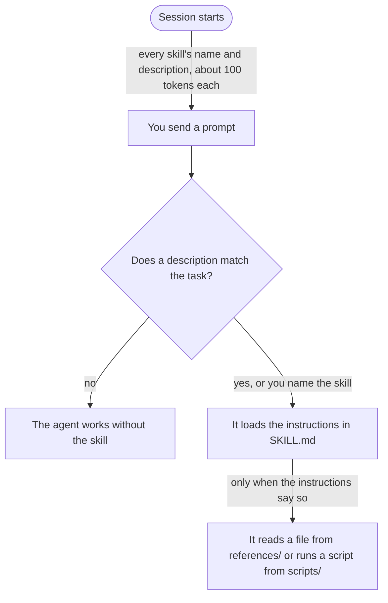

# Skills

A skill is a folder with a `SKILL.md` in it: instructions for one kind of task, and sometimes a script or reference
files that go with them. Your coding agent knows every skill's name and description from the start. When a task
matches a description, it loads the instructions. Until then, a skill costs almost nothing.

That makes a skill the place for knowledge that matters sometimes: how this repository names its tests, how to file
a bug in your tracker, how to use a library well. What matters for every task belongs in `AGENTS.md`. Like an
instruction in `AGENTS.md`, a skill is a request: the agent may skip it. A rule that must hold every time belongs in a
[hook](hooks.md).

Lab 3 installs the Robot Framework Agent Skills and has you write a skill of your own. This page is what you need for
both. Claude Code, Codex and GitHub Copilot all follow the open [Agent Skills](https://agentskills.io/specification)
standard, so a skill written once works in all three.

## How an agent loads a skill



Three levels, each loaded only when needed. You can install dozens of skills and pay for the few a task uses. The
flip side: the agent decides from the description alone. A skill with a vague description never loads, however good
its instructions are.

You can also load a skill yourself: `/<name>` in Claude Code and Copilot, `$<name>` in Codex.

## What goes in the folder

```text
criterion-id-first/
├── SKILL.md          required: the frontmatter and the instructions
├── scripts/          code the agent runs; only its output costs context
├── references/       longer documents the agent reads when SKILL.md points to them
└── assets/           templates and data files
```

`SKILL.md` starts with two required fields:

```yaml
---
name: criterion-id-first
description: Checks that ... Use when ...
---
```

- `name`: lowercase letters, digits and hyphens, at most 64 characters, and **the same as the folder's name**. Copilot
  silently skips a skill whose name breaks these rules.
- `description`: what the skill does and when to use it, at most 1,024 characters. The section below on writing a
  good skill says how.

Each agent knows more fields, for example to stop the model from loading a skill by itself, or to pre-approve tools.
They differ between agents; their documentation lists them:
[Claude Code](https://code.claude.com/docs/en/skills),
[Codex](https://learn.chatgpt.com/docs/build-skills),
[GitHub Copilot](https://docs.github.com/en/copilot/concepts/agents/about-agent-skills) and
[Copilot in VS Code](https://code.visualstudio.com/docs/copilot/customization/agent-skills).

## Where your agent finds it

| | Claude Code | Codex | GitHub Copilot |
|---|---|---|---|
| In this repository | `.claude/skills/<name>/` | `.agents/skills/<name>/` | `.claude/skills/<name>/` |
| For all your repositories | `~/.claude/skills/<name>/` | `~/.agents/skills/<name>/` | `~/.copilot/skills/<name>/` |
| You see it load | `Skill(<name>)` | it reads the skill's `SKILL.md` | `skill(<name>)` |

Copilot reads `.claude/skills/`, `.agents/skills/` and `.github/skills/`. The workshop uses `.claude/skills/`, the
folder it shares with Claude Code. Codex reads only `.agents/skills/`.

An agent reads its skills when a session starts: after you add or change one, start a new session. To see what your
agent has, ask it which skills it has.

## Skill, context file, hook, MCP server or subagent?

| You want | Use | Because |
|---|---|---|
| a fact or rule for every task: how to run the tests, where the shop is | `AGENTS.md` | it is always loaded |
| know-how for one kind of task: a convention, a workflow, a library | a skill | it is loaded only when the task needs it |
| a rule that must hold every time, or a check after every edit | a [hook](hooks.md) | the agent does not decide whether it runs |
| a tool that reaches something outside the repository: a browser, a ticket system | an MCP server (Lab 6) | it adds tools, not instructions |
| a task done in its own context, with only a summary coming back | a subagent (Bonus 3) | it keeps your session's context small |

They combine. A skill can teach the agent how to use an MCP server's tools well. When the agent keeps skipping a
skill's rule, the rule wants to be a hook.

## Worked example: the template

`skills/template/` is a complete skill for [convention 1](conventions.md#1-the-criterion-id-comes-first): test names
start with the criterion's ID. Read it once; here is why it is built the way it is.

```yaml
name: criterion-id-first
description: Checks that Robot Framework test names in this repository start with the story criterion they verify
  (<STORY>_<AC>, for example WEB-006_AC-1) or carry the smoke tag. Use when writing, renaming or reviewing test cases
  in .robot files, or when asked whether tests follow the naming convention.
```

- **The description names what and when.** The first sentence says what the skill checks. The second lists the
  situations, in the words a prompt would contain: *writing*, *renaming*, *reviewing*, *test cases*, *.robot files*,
  *naming convention*.
- **The rule comes first** (`## The rule`), with one example. It is what the agent must not miss.
- **The reason follows** (`## Why`): a failing test names the requirement it protects. An agent that knows why can
  judge a case the rule does not list.
- **How to apply it** is a short procedure for writing and for reviewing, the two jobs the description names.
- **A script for the exact part.** `scripts/check.py` reads the test files the way Robot Framework does, and reports
  each test that breaks the rule. The skill says how to run it and what its output and exit codes mean. Reading test
  names is a job for code, not for the model's eyes.
- **Examples** show the verdict for names that follow the rule and names that break it, including the near misses
  (`AC-7 Audio Filter`: the story is missing).

What it leaves out matters as well: what Robot Framework is, how test cases are written. The agent knows that.

## Writing a good skill

The agents' documentation and the Agent Skills standard agree on most of this. Each rule links where it comes from.

1. **The description does all the triggering.** Say what the skill does and when to use it, in the third person,
   with the words a prompt would contain. Agents tend to load skills too rarely, so name the situations, not only the
   topic. "Helps with tests" never loads; "Use when writing, renaming or reviewing test cases" does.
   ([Anthropic](https://platform.claude.com/docs/en/agents-and-tools/agent-skills/best-practices),
   [Agent Skills](https://agentskills.io/skill-creation/optimizing-descriptions))
2. **Leave out what the model already knows.** Once loaded, every line competes for context with your task. Ask of
   each paragraph: would the agent get this wrong without it? Keep `SKILL.md` well under 500 lines.
   ([Anthropic](https://platform.claude.com/docs/en/agents-and-tools/agent-skills/best-practices),
   [Agent Skills](https://agentskills.io/skill-creation/best-practices))
3. **Explain why.** A reason carries further than ALWAYS or NEVER in capitals: the agent applies it to cases you did
   not list. ([Agent Skills](https://agentskills.io/skill-creation/best-practices),
   [skill-creator](https://github.com/anthropics/skills/blob/main/skills/skill-creator/SKILL.md))
4. **One job per skill.** A skill for two jobs loads for both and does each half-well. Two skills with sharp
   descriptions beat one with a broad one. ([Codex](https://learn.chatgpt.com/docs/build-skills),
   [Agent Skills](https://agentskills.io/skill-creation/best-practices))
5. **A default, not a menu.** Name one way to do it, and when to deviate. A list of five options leaves the agent to
   guess. ([Anthropic](https://platform.claude.com/docs/en/agents-and-tools/agent-skills/best-practices))
6. **A script for what must be exact.** Checks, conversions, anything with a right answer: code does it the same way
   every time, and costs only its output. Say whether the agent should run the script or read it. A script must never
   wait for input; its output and exit code should say what is wrong.
   ([Anthropic](https://platform.claude.com/docs/en/agents-and-tools/agent-skills/best-practices),
   [Agent Skills](https://agentskills.io/skill-creation/using-scripts))
7. **Write down the gotchas, and put the key rule first.** The most valuable lines are often facts about this
   repository that a reasonable agent gets wrong. When you correct the agent, add the correction to the skill. Keep
   the rule near the top: in a long session, the start of a skill is what survives. Claude Code keeps only a skill's
   first 5,000 tokens when it compacts the conversation.
   ([Agent Skills](https://agentskills.io/skill-creation/best-practices),
   [Claude Code](https://code.claude.com/docs/en/skills))
8. **References one level deep, each with its moment.** Link every reference file from `SKILL.md`, not from another
   reference, and say when to read it: "Read `references/errors.md` when the API returns an error."
   ([Anthropic](https://platform.claude.com/docs/en/agents-and-tools/agent-skills/best-practices),
   [Agent Skills](https://agentskills.io/skill-creation/best-practices))

A skill built from your own experience beats one an agent writes from general knowledge. Write it from the review
comments you keep repeating, the steps you keep explaining, the mistakes you keep fixing.

## Evaluate your skill

A skill is only good if it loads when it should, stays quiet otherwise, and makes the result better. Three checks,
each in a new session:

1. **It loads.** A prompt that should need the skill, in words a colleague would use, not copied from the
   description. The session shows the skill loading.
2. **It stays quiet.** A prompt about something else nearby. The skill does not load.
3. **It helps.** The same task with the skill and without it, for example in a copy of the repository without the
   skill's folder. Compare the results, not just whether it loaded.

When it misfires:

| What you see | Likely cause | Change |
|---|---|---|
| It never loads | the description is vague, or uses other words than your prompts | name the situations and the words a prompt contains |
| It loads for everything | the description is too broad | narrow it; say what it is not for |
| It loads, but the agent ignores a rule | too long, or the rule is buried | cut, and move the rule to the top; or make it a hook |
| The result is no better than without it | it tells the agent what it already knows | keep only what the agent got wrong without it |

Keep your test prompts. After each change to the skill, run them again. The next step up is to let one session
write or change the skill and a fresh one test it, and to read how the agent used it: which files it opened, which it
skipped. ([Anthropic](https://platform.claude.com/docs/en/agents-and-tools/agent-skills/best-practices#evaluation-and-iteration),
[Agent Skills](https://agentskills.io/skill-creation/evaluating-skills))

## Trust

A skill is instructions your agent follows and scripts it runs, with your permissions. Install skills the way you
install software: from sources you trust, at a version you pinned, as Lab 3 does with `rf-agentskills`. Read a skill
before you install it, scripts included, and be wary of one that fetches content from the internet: that content
becomes instructions. ([Anthropic](https://platform.claude.com/docs/en/agents-and-tools/agent-skills/overview))

The agents guard their skill folders: Claude Code asks before it writes into `.claude/`, and Codex's sandbox keeps
`.agents/` read-only until you approve the write.

## Going further

- Anthropic's [engineering post](https://www.anthropic.com/engineering/equipping-agents-for-the-real-world-with-agent-skills)
  on why skills are built this way.
- [skill-creator](https://github.com/anthropics/skills/tree/main/skills/skill-creator), a skill that writes skills,
  runs test prompts with and without them and tunes the description. Codex ships its own as `$skill-creator`.
- [skills-ref](https://github.com/agentskills/agentskills/tree/main/skills-ref) checks a skill's frontmatter against
  the standard: `skills-ref validate <folder>`.

*Checked against each agent's documentation on 2026-11-03.*
